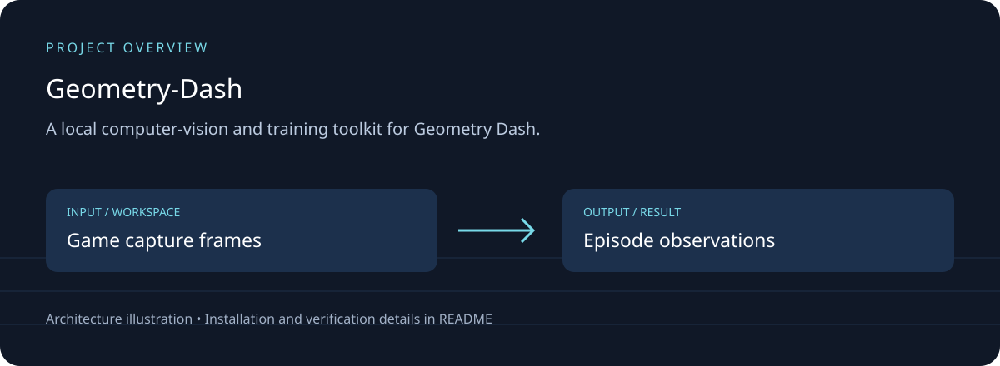

# Geometry Dash — Self-Learning AI

## Download, setup and project overview

A local computer-vision and training toolkit for Geometry Dash.

Frame observation; motion-based episode termination; configuration; local training scripts.



[Download source ZIP](https://github.com/ahpa5246-lgtm/Geometry-Dash/archive/refs/heads/main.zip) · [Changes and branches](https://github.com/ahpa5246-lgtm/Geometry-Dash/branches) · [Verification notes](docs/QUALITY_REVIEW.md)

The ZIP contains source code. Installation steps and external runtime requirements are listed below.

```bash
git clone https://github.com/ahpa5246-lgtm/Geometry-Dash.git
cd Geometry-Dash
```

From the repository directory:

```text
python -m venv .venv
# Activate .venv before installing packages.
python -m pip install -r requirements.txt
# Follow the task-specific CLI / notebook instructions below.
```

The diagram is a project illustration. Test results and runtime limitations are recorded in [the review](docs/QUALITY_REVIEW.md); it is not a production-readiness certification.


A visual reinforcement-learning project that starts from random weights and learns from experience it generates by playing.

No pretrained model, human demonstrations, pre-collected gameplay dataset, obstacle coordinates, player coordinates, or game-memory reading are required.

## Two learning modes

The project now has two complementary modes.

### 1. Live learning — game open

```powershell
python -m gd_ai.train
```

The Recurrent PPO agent:
- sees live 84x84 grayscale pixels;
- chooses hold/release;
- receives survival reward;
- learns online;
- automatically records every transition it generates into `runs/replay/`.

The replay is created by the AI itself. It is not prior data.

### 2. Offline learning — game closed

After the AI has collected replay, Geometry Dash can be completely closed:

```powershell
python -m gd_ai.offline_train
```

This trains a second pixel policy using **discrete Conservative Q-Learning (CQL)** from the agent's own stored experience.

The offline learner uses two consecutive frames as its state so it can infer motion. It can perform hundreds of thousands of gradient updates while the actual game is not running.

Important limitation: while the game is closed, the system can learn more from experiences it already collected, but the real game cannot produce genuinely new states. A later model-based/world-model stage can add imagined rollouts; until then, new exploration still requires occasional live sessions.

## Install

```powershell
.\setup.ps1
```

## Calibrate capture

Open Geometry Dash and run:

```powershell
python -m gd_ai.calibrate
```

Do calibration during active gameplay when tuning the motion detector. The main menu is mostly static and is not a valid measurement of normal gameplay motion.

Optional input check:

```powershell
python -m gd_ai.calibrate --test-input
```

## Live training from zero

Open the target level and leave it in a retry-ready state, then:

```powershell
python -m gd_ai.train
```

A short validation run:

```powershell
python -m gd_ai.train --timesteps 20000
```

Live training writes compressed replay chunks such as:

```text
runs/replay/replay_20260929T..._000001.npz
runs/replay/replay_20260929T..._000002.npz
...
```

Each transition contains only experience generated by the current agent:
- observation;
- action;
- reward;
- next observation;
- terminal flag;
- episode/step identifiers.

## Offline training with the game closed

Once at least one replay chunk exists:

```powershell
python -m gd_ai.offline_train
```

Short test:

```powershell
python -m gd_ai.offline_train --steps 5000
```

Resume:

```powershell
python -m gd_ai.offline_train --resume models/offline_q_latest.pt
```

Offline checkpoints are written under `models/`.

## Test the offline-trained policy in the real game

Open Geometry Dash again and put the level in a retry-ready state:

```powershell
python -m gd_ai.evaluate_offline_q models/offline_q_latest.pt --episodes 10
```

This closes the loop:

```text
LIVE GAME
  ↓
self-generated replay
  ↓
GAME CLOSED
offline CQL learning
  ↓
GAME OPEN
real evaluation + new experience
  ↓
more offline learning
```

## Existing PPO evaluation

```powershell
python -m gd_ai.evaluate models/best_model.zip --episodes 10
```

## Files

- `runs/episodes.csv` — episode duration/reward.
- `runs/monitor.csv` — PPO monitor.
- `runs/replay/` — compressed self-generated replay.
- `runs/tensorboard/` — PPO training metrics.
- `models/checkpoints/` — PPO checkpoints.
- `models/offline_q_latest.pt` — latest offline CQL policy.

See `docs/DESIGN.md` for architecture and limitations.
